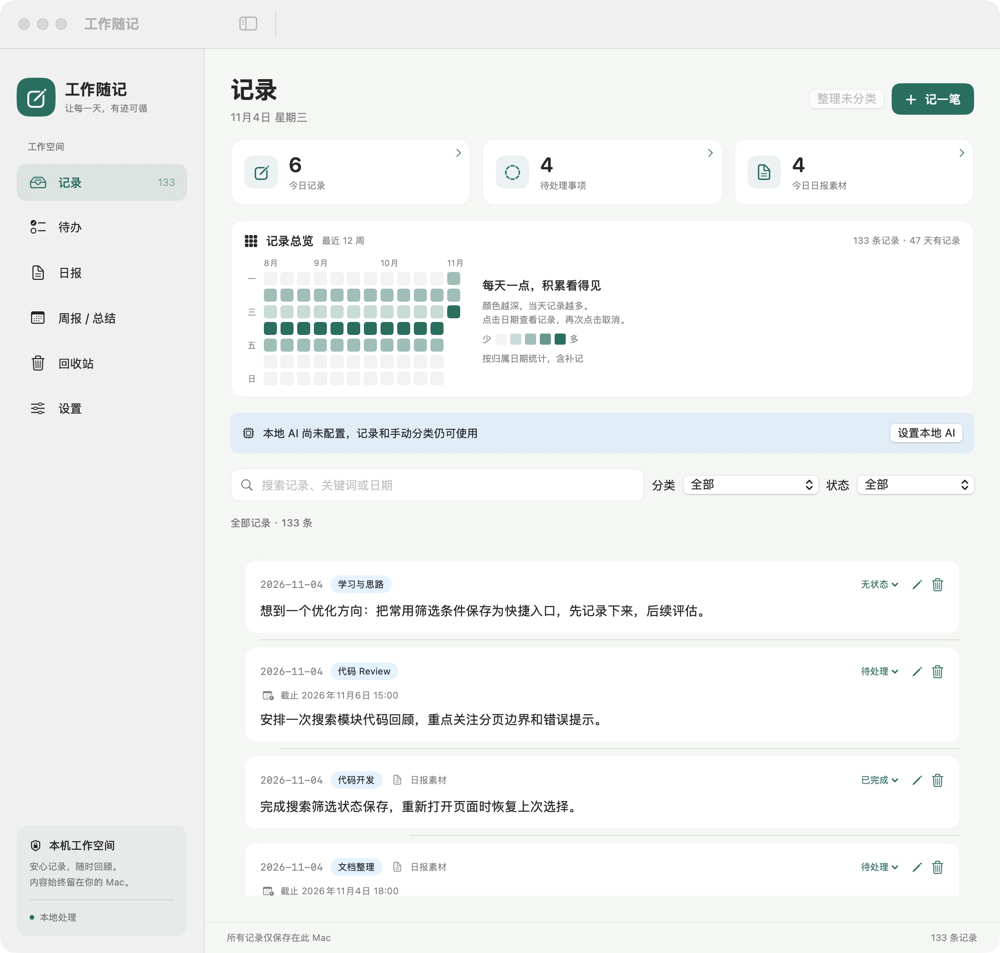
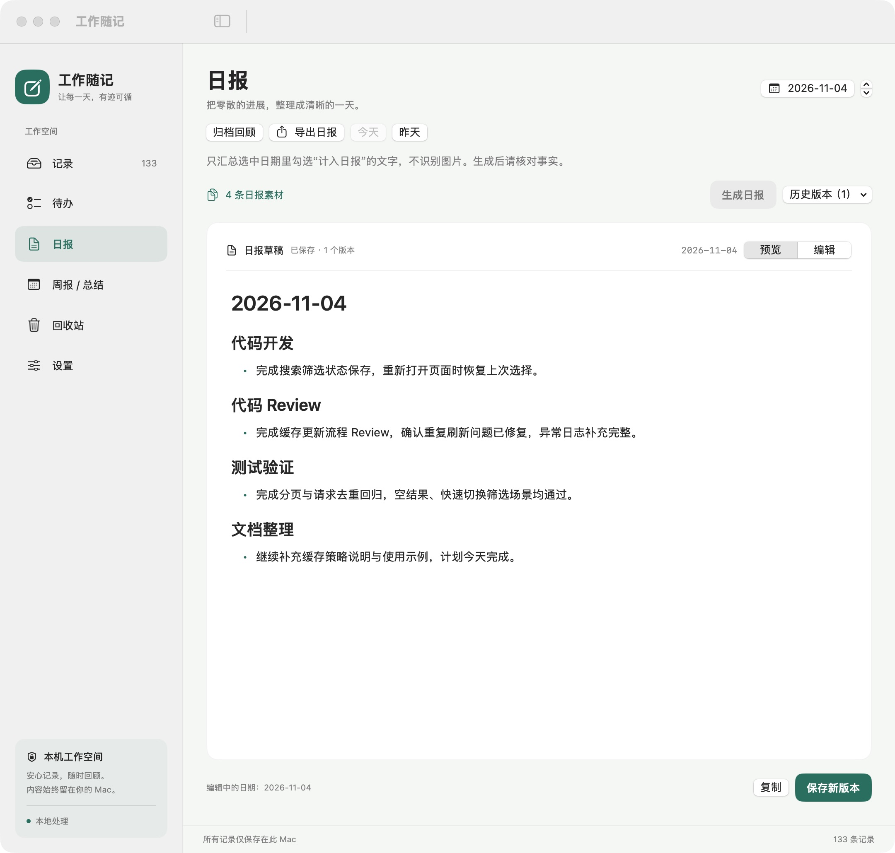
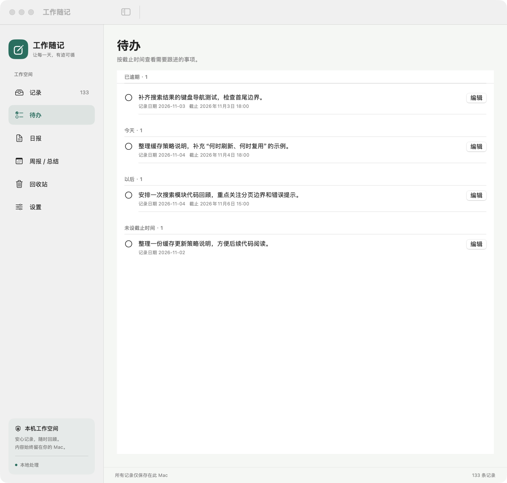
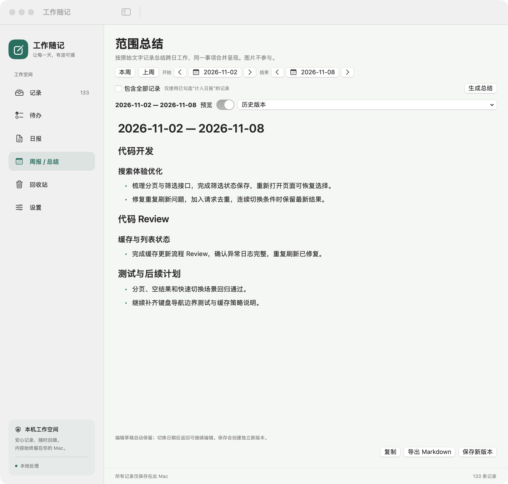

# 工作随记 · WorkJournal

一个在 Mac 本地使用的工作记录、待办跟进与日报工具。原生 SwiftUI / AppKit 界面，SQLite 保存数据，通过本机 Ollama 整理文字。

## 下载与安装

从 [GitHub Releases](https://github.com/bigbrotherwei/WorkJournal/releases/latest) 下载最新版本。当前提供 **Apple 芯片（M 系列）Mac、macOS 14+** 的 `.dmg` 与 `.zip` 安装包；Intel Mac 暂无预构建包。

打开 `.dmg` 后，将 WorkJournal 拖到 Applications；或解压 `.zip` 后将应用移入“应用程序”。安装包不含 Ollama 和模型，需要单独安装。

当前采用 ad-hoc 签名，尚未配置 Apple Developer ID 签名和公证，首次打开可能被 macOS Gatekeeper 拦截。请核实下载来源，仅在信任后按系统提示处理。更新前建议先在应用设置中导出备份。

## 功能

- **随手记录**：全局快捷键打开记录窗口；自动记录日期，支持补记、单一分类、关键词搜索和跟进状态。
- **图文混排**：在文字段落之间插入图片，支持选择文件、粘贴截图、查看大图；草稿自动保留。
- **待办提醒**：设置截止日期和时间，按逾期、今天、以后和未设日期查看；可启用 macOS 本地通知，完成或删除后取消提醒。
- **重复待办**：每天、工作日（周一至周五）、每周或每月重复；完成后保留历史并生成下一期，跳过已过期的周期，新一期默认不计入日报。每月重复保留原始日期，月末不足时取最后一天。
- **稍后提醒**：在待办或通知中延后 30 分钟、1 小时或明天 09:00，待办中也可自选时间；只调整提醒，原截止时间不变。
- **日报**：手动选择日期生成，按工作类型和事项归纳，预览 Markdown、编辑、保存历史版本。可配置固定开头和结尾。
- **周报**：本周、上周或自选日期，直接归纳原始记录，合并跨天的同一事项；默认仅包含日报素材，也可选择全部记录。“历史周报”集中展示所有日期范围的已保存版本和未保存草稿，支持搜索、点击打开、复制及 Markdown 导出。
- **回收站**：删除记录后可恢复文字、图片和元数据，不自动清空；永久删除需要确认。
- **回顾与导出**：近期记录热力图、按日筛选、日报归档、日历多选导出 Markdown。
- **笔记本**：多层目录、图文 Markdown 编辑、源码切换、搜索、拖动归档和自动保存。图片可插入文字段落之间，支持链接、引用、代码、任务列表、表格及常用富文本格式。
- **笔记迁移**：有道云笔记目录、PDF / Markdown / HTML，以及印象笔记 / Evernote 的 ENEX / ENML。先检查、再确认导入；可导出 Markdown、HTML 与完整资源。
- **本地备份**：JSON 导出与合并恢复，包含记录、回收站、日报、周报、笔记目录及全部附件；同 ID 保留本机内容。导入及数据库升级前保留备份。

## 界面体验

- 明亮画布、圆角彩色图标与按日期分组的分类卡片；点击卡片查看完整图文。
- 应用图标采用淡紫圆角记事本与暖色铅笔，Dock 和侧栏使用同一图标。
- 待办可原位展开调整截止时间、重复和提醒，明确保存或取消。
- 日报与周报采用纸张式预览，支持 Markdown 表格；原始文本复制与导出保持一致。

## 界面预览

以下截图来自此前版本，工作内容均为虚构演示数据；0.25.0 已更新为更明亮、圆润的界面。

### 记录与每日总览

查看近期记录热力图，按日期、分类和跟进状态回顾工作。



### 日报 Markdown 预览

按日期查看已保存的日报，支持渲染预览、编辑和版本管理。



### 待办与截止时间

按逾期、今天、以后和未设日期分组，集中跟进待处理事项。



### 周报与自选时间总结

选择本周、上周或自定义日期范围，归纳跨天工作并导出 Markdown。



## 构建与运行

需要 macOS 14+、Swift 6 工具链（Xcode 或 Command Line Tools），无第三方包依赖。

```sh
bash scripts/test.sh
bash scripts/build-app.sh
open dist/WorkJournal.app
```

构建结果采用本机 ad-hoc 签名，尚未做面向其他 Mac 分发的 Apple 公证。构建脚本兼容命令行工具环境；测试脚本按需加载 Swift Testing 宏。

### 自动发布 Releases

版本号来自根目录的 `VERSION`，构建编号来自 `BUILD_NUMBER`。发布前更新这两个文件并提交到公开仓库，再选择一种触发方式：

- **标签触发**：在公开仓库推送与 `VERSION` 完全一致的标签，例如 `v0.22.0`。
- **页面手动触发**：进入 [Actions → Release macOS app](https://github.com/bigbrotherwei/WorkJournal/actions/workflows/release.yml)，点击 **Run workflow**，选择默认分支，填写对应版本标签。标签不存在时，会在通过验证的提交上创建。

流程会先运行测试，再生成 `.app`、ZIP、带 Applications 快捷方式的 DMG 和 `SHA256SUMS.txt`。所有文件上传完成后才会公开 Release；版本与标签不匹配、已有标签指向其他提交或版本已经发布时会停止，避免覆盖旧版本。安装包也会作为 Actions 构建产物保留 7 天。

如果上传中断并留下草稿 Release，请先检查并处理草稿，再重试；流程不会覆盖已有 Release。不要把包含私人开发日志的本地提交历史推送到公开仓库，应只同步审核过的源码变更。

在 Apple 芯片 Mac 上手动生成相同格式的安装包：

```sh
bash scripts/package-release.sh
# 输出位于 dist/release/
cd dist/release
shasum -a 256 -c SHA256SUMS.txt
```

## 开始使用

1. 打开应用，点击「记一笔」。日期自动填写，「计入日报」默认不勾选。
2. 在设置中选择全局快捷键；默认是 **Control + Option + 空格**，实际启用组合以设置页为准。
3. 需要跟进的记录设为「待处理」。可添加截止时间、选择重复周期并勾选「到期时通知我」。首次启用需允许系统通知；设置页提供测试通知。
4. 在「日报」选择目标日期生成。也可以在「周报」选择时间范围生成；点击「历史周报」即可搜索并打开以前的版本或草稿，无需手动匹配起止日期。
5. 核对生成内容后保存新版本，或复制、导出 Markdown。

通知由 macOS 管理，安排成功后退出应用仍有效；系统专注模式和通知设置可能影响展示。已逾期事项显示在待办中，不重复补发通知。通知未获允许不会影响保存记录。

在「待办」点圆圈完成本期重复事项，下一期自动出现；已生成下一期的历史事项不能重新打开，请修改下一期。需要暂缓处理时点「稍后提醒」；通知上的延后操作会打开应用并保存新提醒时间。工作日按周一至周五计算，不包含节假日调休规则。

## 本地模型与隐私

安装并启动 Ollama，下载支持文本生成的本地模型，然后在应用设置中刷新模型列表并选择模型。例如可以使用 `qwen3:4b-instruct`。应用只连接 `127.0.0.1:11434`，拒绝远端/cloud 模型及 HTTP 重定向；不会上传工作记录。

没有 Ollama 也能记录、搜索、手动分类、编辑和备份。自动分类支持省电策略；日报与范围总结均手动触发，模型任务串行运行，长素材会分批整理。

图片仅保存在本机，不参与模型总结或自动分类。每条最多 4 张，输入文件不超过 20 MB；导入时最长边缩至 2048 像素，处理后每张不超过 2 MB；动图仅保留首帧。

模型输出需要人工核对，尤其是完成状态、时间关系和事实细节。生成期间素材变化会使候选结果失效，避免保存过期总结。

## 本地笔记本

在左侧选择「笔记本」，点击目录旁的文件夹按钮建立目录，点击「新建笔记」开始编辑。标题和正文自动保存；目录及笔记可从右键菜单移动、重命名或放入回收站，也可拖到目录中。顶部按钮分别收起导航、目录和笔记列表，收起后仍保留展开入口。

编辑器默认直接显示排版，支持切换 Markdown 源码。图片支持文件选择、粘贴和拖放，可放在文字之间；新插入图片会转为 PNG 并限制最长边为 6000 像素，动图取首帧。导入的原始附件保持原字节。模式切换会重新建立该模式的撤销历史；未识别语法保留为可见原文。笔记不会发送给本地模型或远端服务。

搜索默认覆盖全库，也可关闭「全库搜索」限定当前目录及子目录。「未分类」显示顶层笔记，「最近编辑」显示最近 7 天更新的内容。回收站中切换到「笔记与目录」即可恢复误删内容。

「导入 / 导出」支持选择来源、预检内容、指定目标目录并确认导入：

- **有道云笔记**：读取导出的目录以及 `.md`、HTML、PDF 和同名 `.note.attach` 资源。PDF 原件保留供原样阅读，同时提取可识别的文字。PDF 无法可靠恢复原始段落语义、代码块及图片位置；扫描件不执行 OCR。未知或加密封装会保留原文件并报告。
- **印象笔记 / Evernote**：支持 ENEX、ENML 和 HTML，保留可识别的正文、资源、标签及时间。ENEX 本身没有的笔记本层级无法还原，加密内容不会被假装解密。
- **Markdown**：导入正文及本地关联资源，不自动下载远程图片。再次导入相同来源和内容会跳过重复项；内容或资源改变时保留为新笔记。

导出可以选择当前笔记、当前目录及子目录、全部笔记。Markdown 与 HTML 导出保留目录和相对资源路径；完整 JSON 备份还包括回收站和其他模块。单篇正文上限 8 MiB，单资源上限 128 MiB，一次迁移上限 1 GiB、10,000 篇笔记和 20,000 个资源；完整备份恢复不受单次迁移的总量限制。

## 数据与备份

数据目录：`~/Library/Application Support/WorkJournal/`。记录、总结、笔记和附件保存在 `journal.sqlite`，图文记录草稿保存在 `draft-content.json`，笔记恢复草稿保存在 `NotebookDrafts/`。设置及文字总结编辑草稿保存在本机应用偏好设置中。

在设置中使用「导出完整 JSON 备份」与「从备份合并恢复」。JSON 备份包含已保存的记录、总结版本、笔记目录、笔记正文与附件（含回收站），不包含快捷键、模板等偏好设置及尚未保存的编辑草稿。升级自动生成的 `.sqlite` 快照保存在数据目录的 `Backups/`，它与 JSON 合并恢复格式不同。

合并备份时，同一重复待办系列也保留本机版本，避免出现两份活跃待办。0.26.0 使用数据格式 v5；升级前自动保留数据库快照，新格式不能由旧版应用直接打开。

本仓库包含程序源码、测试、图标、构建脚本及使用虚构数据的界面截图，不包含真实工作记录、用户图片、模型文件或本地备份。

## 验证

```sh
# 常规测试，无需本地模型
bash scripts/test.sh

# 可选：仅使用虚构样例验证本地模型，不读取工作数据库
WORKJOURNAL_LIVE_MODEL=qwen3:4b-instruct bash scripts/test.sh --filter LiveRangeSummaryTests
```

仍建议在实际设备上检查系统通知权限、快捷键冲突及全屏窗口行为。应用处于持续迭代阶段，重要内容请定期导出备份。
